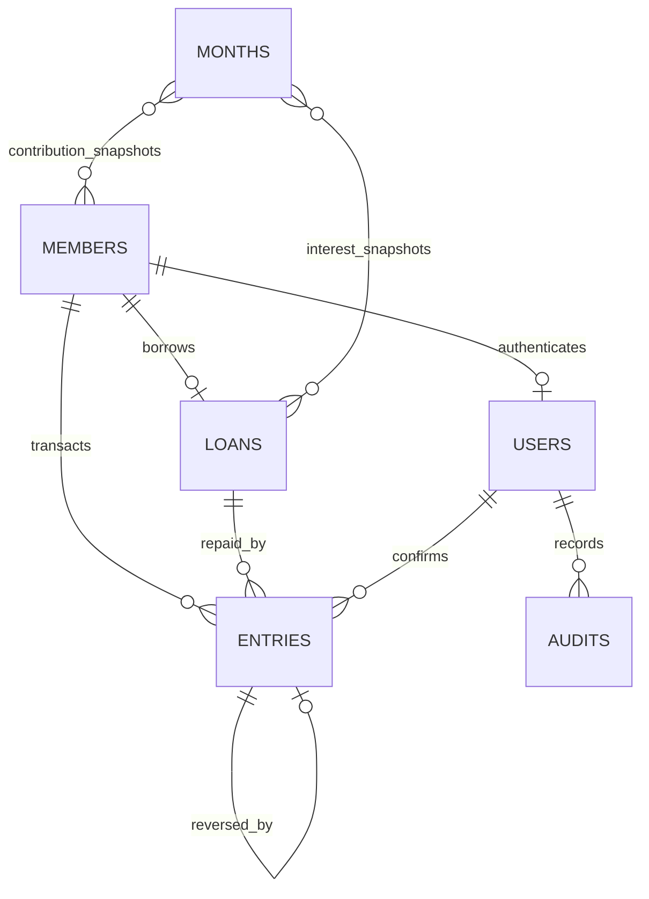

# MongoDB database

Add only `MONGODB_URL` in `Backend/.env`. The application uses the `committee` database on that connection. Use MongoDB Atlas or a transaction-capable replica set. No SQL tables or manual SQL migrations are needed.

On startup, `src/config/database.js` creates all six collections, builds the indexes, and creates the first administrator if none exists. It preserves existing records and does not insert sample financial data or reset passwords. `npm run db:init --workspace Backend` also runs this setup without starting the API.

| Collection | Schema file | Stored information | Main indexes |
| --- | --- | --- | --- |
| `users` | `src/models/User.js` | Login, bcrypt password hash, role, active flag, optional legacy member reference | Unique login; unique linked member; partial unique administrator role |
| `members` | `src/models/Member.js` | Member ID, name, father's name, active flag, joining month, dated share assignments | Unique member code; active/joining month |
| `loans` | `src/models/Loan.js` | Member reference, principal, date, monthly rate in basis points, guarantee and exception approval | Unique member (current single-loan design); date |
| `months` | `src/models/Month.js` | Reporting month, member contribution obligations, loan interest assessed for that month | Unique reporting month |
| `entries` | `src/models/Entry.js` | Contributions, principal and interest allocations, cash movement, transaction date, request key, reversal reference, recording administrator | Unique request key; unique reversal target; member/month/date; loan/date; date/type |
| `audits` | `src/models/Audit.js` | Administrator reference, action, affected record, explanatory details, timestamp | Actor/time; record/time |

Monthly contribution obligations and monthly interest assessments are embedded in each `months` document. They are snapshots rather than values recalculated from today's share assignment. Cash movements and repayments are in `entries`, so a payment's allocations do not double-count its cash amount. Reversals append a separate negative entry referencing the original payment.

All models include creation/update timestamps. Money is stored as integer paise, with safe-integer and sign validation. Interest uses integer arithmetic. Dates use validated `YYYY-MM-DD` values and reporting months use `YYYY-MM`. Schemas reject unknown fields, invalid roles/types, duplicate member/loan items in snapshots, invalid guarantee exceptions, inconsistent payment totals, and malformed reversal entries. Mongoose reference fields identify relationships; API transactions enforce account existence and balances. MongoDB does not provide SQL-style foreign keys. Direct database writes bypass Mongoose validation and must not be used for ordinary financial edits.

For local development, the automatically generated session signing secret is saved in `Backend/.runtime/session-secret`. First-run administrator credentials are saved in `Backend/.runtime/admin-credentials.json`; read that local file to sign in. These files are excluded from Git and are never returned by the API or printed to logs. Keep `.runtime` private and persistent for local development. On Render, the Blueprint generates a persistent `JWT_SECRET` environment variable instead, so no runtime files need uploading. Production uses the administrator already stored in MongoDB and refuses to create one on an empty database. Existing administrators are never overwritten by initialization. Removing the credentials file does not reset an existing database password.

There is exactly one administrator identity, enforced by the `one_administrator` partial unique index. Administrator login requires only that account's password. No registration route can create another administrator. New member profiles do not create user logins. Password-free members can access aggregate updates, a member-name directory, and a selected read-only financial summary through `GET /api/public/updates`, `GET /api/public/members`, and `GET /api/public/members/:id`. Name options include a member ID to distinguish duplicate names. The public summary includes contribution balances, principal, interest and transaction amounts; it excludes administrator notes, guarantor details and authentication data. Protected account and mutation routes require authentication; the role choice in the browser never grants administrator permissions.

Back up the MongoDB database using Atlas snapshots, preserve the runtime signing secret separately, and test restoration to an isolated database before production use. Database initialization creates missing collections and indexes; it does not drop data, run `syncIndexes`, or silently repair incompatible old data. Index conflicts stop startup for review.

